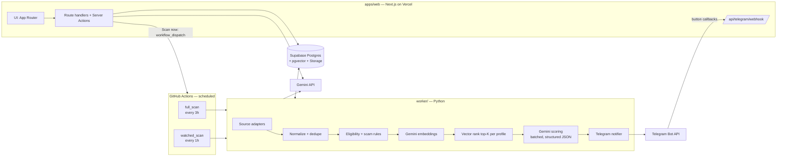

# SCOUT — Architecture

Read `PRD.md` first for scope. This document is the technical source of truth. If an external API described here behaves differently when you test it, **verify against the live endpoint/docs, then update this file** — do not silently diverge.

---

## 1. System overview



**Why this shape**
- **No always-on server.** The worker runs on GitHub Actions cron (free, has Playwright support). The web app + Telegram webhook live on Vercel serverless. Supabase holds all state.
- **Python for scraping/ML** (python-jobspy, Playwright, selectolax). **TypeScript for UI** and request-time AI (resume parse, tailor).
- Both sides talk only to Supabase and Gemini; they never call each other except the "Scan now" dispatch.

---

## 2. Repository layout

```
scout/
├─ CLAUDE.md  PRD.md  ARCHITECTURE.md  DESIGN.md  TASKS.md
├─ docs/design/                 # Stitch screenshots — UI source of truth
├─ apps/web/                    # Next.js app
│  ├─ app/
│  │  ├─ (auth)/login/page.tsx
│  │  ├─ (app)/layout.tsx       # sidebar + topbar shell
│  │  ├─ (app)/dashboard/page.tsx
│  │  ├─ (app)/jobs/page.tsx    # feed; drawer via ?job=<id>
│  │  ├─ (app)/watched/page.tsx
│  │  ├─ (app)/tracker/page.tsx
│  │  ├─ (app)/programs/page.tsx
│  │  ├─ (app)/settings/[section]/page.tsx
│  │  └─ api/ (auth, telegram/webhook, scan, resume, jobs/[id]/tailor)
│  ├─ components/ (ui/, shell/, radar/, jobs/, tracker/, …)
│  ├─ lib/ (db.ts, auth.ts, gemini.ts, telegram.ts, scan-schedule.ts, referrals.ts)
│  ├─ styles/tokens.css
│  └─ middleware.ts
├─ worker/                      # Python 3.12, uv
│  ├─ scout_worker/
│  │  ├─ main.py                # CLI: full | watched | reminders
│  │  ├─ config.py
│  │  ├─ db.py
│  │  ├─ models.py              # pydantic Job, Match, …
│  │  ├─ sources/               # one module per adapter
│  │  ├─ ats/                   # greenhouse, lever, ashby, workday, smartrecruiters, generic, detect.py
│  │  ├─ pipeline/              # normalize, dedupe, eligibility, scam, embed, rank, score
│  │  ├─ notify/telegram.py
│  │  └─ programs/              # seed loader + hackathon scraper
│  ├─ data/programs.yaml
│  └─ tests/
├─ supabase/migrations/*.sql
└─ .github/workflows/ (full_scan.yml, watched_scan.yml, ci.yml)
```

---

## 3. Tech stack

| Layer | Choice |
|---|---|
| Web | Next.js (latest stable, App Router), TypeScript strict, pnpm |
| Styling | Tailwind CSS v4 + CSS variables from `DESIGN.md`; shadcn/ui primitives restyled to tokens |
| Motion | `motion` (`motion/react`) with `LazyMotion` + `domAnimation`; CSS keyframes for loops |
| UI libs | lucide-react, cmdk (⌘K), @dnd-kit (kanban), sonner (toasts), next-themes, @tanstack/react-virtual |
| Validation | zod |
| Auth | bcryptjs + jose (signed JWT cookie) |
| DB access (web) | @supabase/supabase-js, **server-only**, service-role key; generated types |
| AI (web) | `@google/genai` |
| Worker | Python 3.12, uv, httpx (async), pydantic v2, psycopg 3 + pgvector, `google-genai`, python-jobspy, selectolax, Playwright (chromium), tenacity, structlog, ruff, pytest |
| DB | Supabase Postgres + pgvector + Storage |
| Scheduling | GitHub Actions cron + `workflow_dispatch` |
| Alerts | Telegram Bot API (webhook to Vercel) |

---

## 4. Data model

All tables carry `created_at timestamptz default now()`. Every per-user table has `profile_id` and **every query filters by it**. RLS is enabled on all tables with no anon policies; only the service role (server-side) reads/writes.

```sql
create extension if not exists vector;
create extension if not exists pg_trgm;

create type job_type as enum ('internship','full_time','unknown');
create type scam_risk as enum ('none','low','high');
create type match_status as enum ('new','saved','skipped','applied');
create type app_stage as enum ('saved','applied','oa','interview','offer','rejected');
create type ats_type as enum ('greenhouse','lever','ashby','workday','smartrecruiters','generic');
create type program_category as enum ('gsoc','lfx','mlh','hackathon','off_campus','other');

create table profiles (
  id uuid primary key default gen_random_uuid(),
  slug text unique not null,                 -- 'user-01', 'user-02'
  display_name text not null,
  avatar_path text,                          -- storage: avatars/
  college text                               -- used by referral helper
);

create table resumes (
  id uuid primary key default gen_random_uuid(),
  profile_id uuid not null references profiles(id) on delete cascade,
  file_path text not null,                   -- storage: resumes/
  raw_text text not null,
  parsed jsonb not null,                     -- see §8.2 schema
  skills text[] not null default '{}',
  embedding vector(768),
  is_active boolean not null default true
);

create table preferences (
  profile_id uuid primary key references profiles(id) on delete cascade,
  roles text[] not null default '{}',        -- search terms, e.g. 'machine learning intern'
  locations text[] not null default '{}',    -- 'India','Bangalore',…
  remote_ok boolean not null default true,
  job_types job_type[] not null default '{internship,full_time}',
  grad_year int,
  degree text,                               -- 'B.Tech CSE (Data Science)'
  max_experience_years int not null default 1,
  has_active_backlogs boolean,
  min_score int not null default 60,
  telegram_chat_id bigint,
  telegram_link_token text,
  telegram_link_expires_at timestamptz,
  telegram_linked_at timestamptz
);

create table companies (
  id uuid primary key default gen_random_uuid(),
  name text not null,
  domain text,
  logo_url text,
  careers_url text,
  ats ats_type,
  ats_token text,                            -- board token / slug / workday tenant+site
  content_hash text,                         -- generic fallback change detection
  unique (ats, ats_token)
);

create table watched_companies (
  profile_id uuid references profiles(id) on delete cascade,
  company_id uuid references companies(id) on delete cascade,
  instant_alerts boolean not null default true,
  last_checked_at timestamptz,
  last_open_count int,
  last_new_count int,
  last_error text,
  primary key (profile_id, company_id)
);

create table jobs (
  id uuid primary key default gen_random_uuid(),
  dedupe_key text unique not null,
  sources text[] not null,                   -- ['greenhouse','linkedin']
  source_ids jsonb not null default '{}',    -- {source: source_job_id}
  company_id uuid references companies(id),
  company_name text not null,
  title text not null,
  location text,
  is_remote boolean not null default false,
  job_type job_type not null default 'unknown',
  description text,
  apply_url text not null,
  posted_at timestamptz,
  first_seen_at timestamptz not null default now(),
  last_seen_at timestamptz not null default now(),
  is_active boolean not null default true,
  scam_risk scam_risk not null default 'none',
  scam_reasons text[] not null default '{}',
  embedding vector(768),
  raw jsonb
);
create index on jobs using hnsw (embedding vector_cosine_ops);
create index on jobs (posted_at desc);
create index on jobs using gin (title gin_trgm_ops);

create table job_matches (
  id uuid primary key default gen_random_uuid(),
  profile_id uuid not null references profiles(id) on delete cascade,
  job_id uuid not null references jobs(id) on delete cascade,
  similarity real not null,
  score int,                                 -- null until Gemini-scored
  rank_score real,                           -- §7.6
  breakdown jsonb,                           -- {skills, eligibility, freshness}
  eligibility jsonb,                         -- [{label, status:'pass'|'fail'|'unknown'}]
  missing_skills text[] not null default '{}',
  reason text,
  eligible boolean not null default true,
  status match_status not null default 'new',
  notified_at timestamptz,
  unique (profile_id, job_id)
);

create table applications (
  id uuid primary key default gen_random_uuid(),
  profile_id uuid not null references profiles(id) on delete cascade,
  job_id uuid references jobs(id) on delete set null,
  company_name text not null,
  role text not null,
  apply_url text,
  stage app_stage not null default 'saved',
  position int not null default 0,           -- order within column
  applied_at date,
  next_action_label text,                    -- 'Interview','Follow up','OA due'
  next_action_at date,
  reminder_sent_at timestamptz,
  notes text,
  updated_at timestamptz not null default now(),
  unique (profile_id, job_id)
);

create table tailored_outputs (
  id uuid primary key default gen_random_uuid(),
  profile_id uuid not null references profiles(id) on delete cascade,
  job_id uuid not null references jobs(id) on delete cascade,
  resume_id uuid not null references resumes(id) on delete cascade,
  bullets jsonb not null,                    -- string[3]
  cover_note text not null,
  ats_keywords text[] not null default '{}',
  unique (profile_id, job_id, resume_id)
);

create table programs (
  id uuid primary key default gen_random_uuid(),
  name text not null,
  organizer text,
  category program_category not null,
  url text not null unique,
  logo_url text,
  description text,
  opens_at date,
  deadline_at date not null,
  source text not null default 'seed'        -- 'seed'|'mlh'|'manual'
);

create table program_reminders (
  profile_id uuid references profiles(id) on delete cascade,
  program_id uuid references programs(id) on delete cascade,
  sent_7d_at timestamptz,
  sent_1d_at timestamptz,
  primary key (profile_id, program_id)
);

create table scan_runs (
  id uuid primary key default gen_random_uuid(),
  kind text not null check (kind in ('full','watched','manual')),
  status text not null default 'running' check (status in ('running','success','partial','failed')),
  started_at timestamptz not null default now(),
  finished_at timestamptz,
  stats jsonb not null default '{}'
);

create table source_runs (
  id uuid primary key default gen_random_uuid(),
  scan_run_id uuid not null references scan_runs(id) on delete cascade,
  source text not null,
  status text not null default 'running',
  fetched int not null default 0,
  new_jobs int not null default 0,
  error text,
  finished_at timestamptz
);

create table llm_usage (                     -- quota guard
  day date not null,
  kind text not null,                        -- 'embed'|'score'|'parse'|'tailor'|'extract'
  requests int not null default 0,
  primary key (day, kind)
);
```

**RPCs**
- `similar_jobs(p_job_id uuid, p_k int)` — cosine neighbours among active jobs (drawer "Similar" tab).
- `match_candidates(p_profile uuid, p_embedding vector, p_since timestamptz, p_k int)` — unscored active eligible jobs ranked by similarity.
- `dashboard_kpis(p_profile uuid)` — New today, Fresh < 24h, Applied this week, Interviews + 7-day series for sparklines.

---

## 5. Job sources

Every adapter implements:

```python
class Source(Protocol):
    name: str                        # 'remoteok'
    kind: Literal['aggregator','remote','ats','scrape']
    enabled: bool                    # from env ENABLE_<NAME>
    async def fetch(self, ctx: FetchContext) -> list[RawJob]: ...
```

`FetchContext` contains the union of both profiles' `roles`, `locations`, `job_types`, plus `since` (last successful run − 1h overlap). Adapters must: use a shared `httpx.AsyncClient` with a real User-Agent, timeouts (20s), `tenacity` retry (3x, exponential), and never raise — errors are recorded in `source_runs` and the scan continues.

| Source | Method | v1 | Notes |
|---|---|---|---|
| LinkedIn, Indeed, Google Jobs, Naukri, Glassdoor | `python-jobspy` `scrape_jobs(...)` | ✅ | One call per role term, `hours_old=72`, modest `results_wanted`. Verify supported sites in installed version. Most fragile source — isolate failures. |
| Adzuna | REST API (`/v1/api/jobs/in/search/{page}`) | ✅ | Free key. India. |
| Internshala | HTML scrape of listing pages | ✅ flag | Respect robots.txt, 1 req/2s, selectors in one module. |
| RemoteOK | `https://remoteok.com/api` | ✅ | Skip first element (legal notice). Attribute source. |
| Remotive | `https://remotive.com/api/remote-jobs` | ✅ | Use `search` param. |
| Himalayas | public jobs API | ✅ | Verify current endpoint. |
| Arbeitnow | `https://www.arbeitnow.com/api/job-board-api` | ✅ | |
| We Work Remotely | RSS feeds per category | ✅ | |
| Greenhouse | `GET https://boards-api.greenhouse.io/v1/boards/{token}/jobs?content=true` | ✅ | Watched companies + curated list |
| Lever | `GET https://api.lever.co/v0/postings/{company}?mode=json` | ✅ | |
| Ashby | `GET https://api.ashbyhq.com/posting-api/job-board/{board}?includeCompensation=true` | ✅ | |
| Workday | `POST https://{tenant}.wd{n}.myworkdayjobs.com/wday/cxs/{tenant}/{site}/jobs` body `{"appliedFacets":{},"limit":20,"offset":0,"searchText":""}` | ✅ | Paginate; details via `…/job/{path}` |
| SmartRecruiters | `GET https://api.smartrecruiters.com/v1/companies/{id}/postings` | ✅ | |
| Generic careers page | Playwright render → extract | ✅ | Watched companies only (§6) |
| Hackathons (programs) | MLH season events page scrape | ✅ | Feeds `programs`, not `jobs` |

Wellfound and JSearch are **not** in v1 (anti-bot / paid). The UI source list is driven by `source_runs`, never hard-coded.

A curated `worker/data/ats_companies.yaml` (e.g. 50–100 companies known to hire interns, with ATS + token) is scanned on every full scan in addition to watched companies.

---

## 6. Watched companies & ATS detection

`ats/detect.py` resolves a pasted URL in this order:

1. **URL patterns**
   - `boards.greenhouse.io/{token}`, `job-boards.greenhouse.io/{token}` → greenhouse
   - `jobs.lever.co/{company}` → lever
   - `jobs.ashbyhq.com/{board}` → ashby
   - `{tenant}.wd{n}.myworkdayjobs.com/{locale?}/{site}` → workday
   - `careers.smartrecruiters.com/{company}` / `jobs.smartrecruiters.com/{company}` → smartrecruiters
2. **Page inspection** — fetch HTML (httpx; Playwright if the body is near-empty) and search for embedded markers: `boards.greenhouse.io/embed/job_board?for=`, `greenhouse.io/…/{token}`, `jobs.lever.co/`, `jobs.ashbyhq.com/`, `myworkdayjobs.com`, `smartrecruiters.com`. Validate by calling the ATS API once.
3. **Generic fallback** — render with Playwright, collect anchor links whose text/URL look like job postings, hash the normalized job-list text into `companies.content_hash`. **Only if the hash changed**, send the cleaned text to Gemini extraction (§8.4) to get `[{title, location, url}]`.

Detection runs synchronously in a web route (`POST /api/watched`) for patterns 1–2 via the ATS API (fast); generic pages are marked `pending` and resolved by the next watched scan (Playwright is not run on Vercel).

**Watched scan (hourly):** for each `companies` row with ≥1 watcher → fetch roles → upsert jobs (`company_id` set) → mark roles not returned as `is_active=false` → compute `new_count` (first seen this run) → update `watched_companies` → for watchers with `instant_alerts` → run eligibility + scam rules → send one Telegram message per new eligible role (F2). Watched alerts are **not** gated by `min_score`; they show the score if available.

---

## 7. Pipeline (full scan)

```
fetch all sources (concurrent, per-source timeout)
 → normalize → dedupe/upsert
 → scam rules (all new jobs)
 → embed new jobs (batched)
 → for each profile:
     eligibility rules → candidate set
     vector rank top-K unscored → Gemini score (batched)
     compute rank_score
     notify (fresh individual + digest)
 → reminders (tracker next actions, programs)
 → close scan_run
```

### 7.1 Normalize
`RawJob → Job`: trim/clean HTML (selectolax → text, max 8k chars kept for scoring), parse `posted_at` (relative strings like "3 days ago" → absolute; missing → `first_seen_at`), infer `job_type` (title/desc contains intern/internship/trainee → internship), `is_remote` (location or flags contain remote/anywhere/WFH), canonicalize `apply_url` (strip utm_*, ref, source params).

### 7.2 Dedupe
`dedupe_key = sha1(norm(company) | norm(title) | norm(location_city_or_'remote'))` where `norm` lowercases, strips punctuation, company suffixes (inc, ltd, pvt, technologies, labs), and seniority noise. On conflict: append source, merge `source_ids`, keep the **ATS** `apply_url` over aggregator URLs, keep the longest description, update `last_seen_at`.

### 7.3 Eligibility rules (F3) — `pipeline/eligibility.py`
Per profile, a job is **ineligible** if any:
- Title matches `\b(senior|sr\.?|lead|staff|principal|manager|head|director|architect|vp)\b` (case-insensitive).
- Description requires experience > `max_experience_years`: regex over `(\d+)\s*\+?\s*(?:-|to)?\s*(\d+)?\s*(?:years|yrs)` near "experience"; take the minimum mentioned.
- Description restricts graduation/batch years (e.g. `2024 (?:and|/|,) 2025 batch`, `graduating in 2026`) and `grad_year` is not among them.
- `job_type` not in profile `job_types` (unknown passes).
- Location not in profile `locations` and not remote (if `remote_ok`) — fuzzy match on city/country.

Ineligible jobs still get a `job_matches` row with `eligible=false` (so the "Eligible only" toggle can reveal them) but are never scored or notified.

### 7.4 Scam rules (F4) — `pipeline/scam.py`
Heuristic score → `none/low/high`:
- high: `registration fee|training fee|security deposit|pay(ment)? to (join|apply)|refundable deposit|processing fee`
- +low each: contact via WhatsApp/Telegram only; recruiter email on gmail/yahoo/outlook for a non-tiny company; stipend/salary wildly above market phrasing ("earn ₹50,000 per week"); "no interview" + "immediate joining" + "work from home" together; missing company name.
- 2+ low signals → high.
Gemini scoring (§8.3) can raise (never lower) risk with a reason. Store `scam_reasons` as short human strings.

### 7.5 Embeddings
- Model: `GEMINI_EMBED_MODEL` (env), `output_dimensionality=768`, task type `RETRIEVAL_DOCUMENT` for jobs, `RETRIEVAL_QUERY` for the resume profile text.
- Job text = `title + company + location + first 2,000 chars of description`.
- Batch requests (≤100 inputs/request). Only embed jobs without an embedding.
- Resume embedding is computed when a resume is uploaded/edited (web side) from `summary + skills + project titles + target roles`.

### 7.6 Ranking
1. `match_candidates`: eligible, active, `scam_risk != 'high'`, not yet scored for this profile, `first_seen_at > now() - 7 days`, ordered by cosine similarity, `K = SCORE_TOP_K` (default 20).
2. Gemini scores those K (§8.3) in batches of `SCORE_BATCH_SIZE` (default 5).
3. `freshness = 100` if posted < 24h, linear decay to 0 at 14 days.
4. `rank_score = 0.75 * score + 0.25 * freshness` (+5 if company is watched by the profile).
5. `breakdown = {skills: score_skills, eligibility: % of eligibility checks passing, freshness}`.

### 7.7 Notifications (F1, F2, F6)
After scoring, per profile with a linked chat:
- **Fresh individual:** `score ≥ min_score` and posted < 24h and not notified → one message each, highest rank first, max `MAX_INDIVIDUAL_ALERTS` (8).
- **Digest:** remaining `score ≥ min_score` not notified → one message listing up to 10 (title — company · match% · link), plus "View all in SCOUT" URL button.
- Set `notified_at` on send. Never notify `skipped`, `applied`, ineligible, or high scam risk.
- Respect Telegram limits: ≤1 msg/sec per chat; on 429 obey `retry_after`.

### 7.8 Reminders
Run at the end of every full scan (`main.py reminders` also callable):
- `applications.next_action_at = today` and `reminder_sent_at is null` → send, set `reminder_sent_at`.
- `program_reminders` where deadline in 7 days / 1 day and corresponding `sent_*` null → send, stamp.
All dates evaluated in `Asia/Kolkata`.

---

## 8. Gemini usage (free tier)

**Rules:** all calls go through one wrapper per runtime (`worker/.../llm.py`, `apps/web/lib/gemini.ts`) that: reads model names from env, uses structured output (`response_mime_type: application/json` + `response_schema`), increments `llm_usage`, retries on 429/503 with backoff honoring retry hints, and refuses new calls when a daily soft cap (`LLM_DAILY_SOFT_CAP_*`) is hit — the pipeline then degrades gracefully (similarity-only ranking, no new tailoring) instead of failing. Check current free-tier limits and model names in Google's docs at build time; set caps below them.

Budget estimate per day: 8 full scans × 2 profiles × (20/5 = 4 scoring calls) = 64 score calls + embeddings batches + a handful of parse/tailor/extract calls.

### 8.1 Models (env)
- `GEMINI_MODEL` — fast Flash-class model for scoring, extraction, tailoring, parsing.
- `GEMINI_EMBED_MODEL` — Gemini embedding model.

### 8.2 Resume parse (web, on upload)
Input: extracted resume text (pdf-parse / mammoth for DOCX). Output schema:
```json
{
  "name": "string", "email": "string|null", "college": "string|null",
  "degree": "string|null", "grad_year": "integer|null",
  "summary": "string (2 sentences, factual)",
  "skills": ["string"],
  "experience": [{"title":"string","org":"string","start":"string|null","end":"string|null","bullets":["string"]}],
  "projects": [{"name":"string","tech":["string"],"bullets":["string"]}],
  "target_roles": ["string"]
}
```
Prefill `preferences.grad_year`, `degree`, `roles`, and `profiles.college` if empty.

### 8.3 Job scoring (worker, batched)
System instruction (summarized — store full text in `worker/scout_worker/prompts/score.md`):
> You evaluate job fit for one candidate. Use only facts in the candidate profile and job text. Do not invent requirements. Missing skills must be skills explicitly mentioned in the job text and absent from the candidate profile. Scam signals must be quoted from the job text.

Input: candidate profile JSON (from `resumes.parsed` + preferences) + array of `{job_id, title, company, location, description}`.

Output schema (array, one per job):
```json
{
  "job_id": "string",
  "score": "integer 0-100",
  "skills_score": "integer 0-100",
  "reason": "string ≤ 140 chars",
  "missing_skills": ["string (max 4)"],
  "eligibility": [{"label": "string", "status": "pass|fail|unknown"}],
  "scam_signals": ["string"]
}
```
Scoring guidance in prompt: 90+ = near-perfect role/skill/level fit; 70–89 = strong; 50–69 = partial; <50 = weak. Validate with pydantic; drop items with unknown `job_id`; clamp ranges.

### 8.4 Generic careers page extraction (worker)
Input: cleaned visible text + list of links (≤6k chars). Output: `[{title, location|null, url}]`. Only links present in input are accepted.

### 8.5 Tailoring (F8, web, on demand)
Input: `resumes.parsed` + job title/company/description. Output:
```json
{ "bullets": ["string","string","string"], "cover_note": "string (≤120 words)", "ats_keywords": ["string"] }
```
Prompt rules: rewrite only real experience/projects; no new employers, metrics, or tools the candidate doesn't have; weave in JD keywords where truthful. Cache in `tailored_outputs`; Regenerate overwrites.

---

## 9. Telegram

- Bot created via BotFather; webhook set to `https://<web>/api/telegram/webhook` with `secret_token`. Webhook handler verifies header `X-Telegram-Bot-Api-Secret-Token`.
- **Linking:** Settings → "Connect Telegram" creates `telegram_link_token` (random 16 bytes, base64url, 15-min expiry) and shows QR + `https://t.me/<BOT_USERNAME>?start=<token>`. `/start <token>` in webhook → match token → store `chat_id`, clear token, reply "Linked to <display_name>".
- Only messages/callbacks from known `chat_id`s are processed; everything else gets no reply.
- **Message format (HTML parse mode):**
  ```
  <b>{title}</b> — {company}
  {location} · {posted_ago} · <b>{score}% match</b>
  Missing: {missing_skills}
  ```
  Prefix line `FRESH` for < 24h, `WATCHED` for watched-company alerts.
- **Inline keyboard:** row 1 `[Apply ↗]` (url button); row 2 `[Save] [Skip] [Applied ✓]`.
- **callback_data** (≤64 bytes): `s:<match_uuid>`, `k:<match_uuid>`, `a:<match_uuid>`. Handler updates `job_matches.status`, upserts `applications` (save → stage saved; applied → stage applied, `applied_at=today`), answers the callback, and edits the keyboard to show state (e.g. `✓ Applied`).
- Webhook must respond < 10s; do DB work inline (it's small).

---

## 10. Web app

### 10.1 Auth (two profiles, one password)
- `APP_PASSWORD_HASH` (bcrypt) in env. `POST /api/auth/login {profileSlug, password}` → compare → set cookie `scout_session` = JWT (`jose`, HS256, `SESSION_SECRET`, 30 days) with `{pid, slug}`; `httpOnly`, `secure`, `sameSite=lax`.
- Rate limit: max 5 failed attempts per IP per 15 min (store in a small `login_attempts` table or in-memory Map per instance — table preferred).
- `middleware.ts` protects everything except `/login`, `/api/auth/*`, `/api/telegram/webhook`, static assets.
- `POST /api/auth/switch {profileSlug}` re-signs the cookie for the other profile (session must be valid).
- `lib/session.ts#requireProfile()` used in every server component/action; returns `profile_id`.

### 10.2 Data access
- `lib/db.ts` exports a server-only Supabase client (service role). Import `server-only` at top. Never expose service key or Gemini key to the client.
- Reads in Server Components; mutations via Server Actions with zod validation; revalidate the relevant paths.
- Live scan status: client component polls `GET /api/scan/status` every 5s while a run is `running`, every 60s otherwise.
- Next scan countdown: computed client-side from `SCAN_CRON` (next 3-hour UTC boundary) — `lib/scan-schedule.ts`.

### 10.3 Route handlers
| Route | Purpose |
|---|---|
| `POST /api/auth/login`, `/logout`, `/switch` | Session |
| `POST /api/telegram/webhook` | Bot updates/callbacks |
| `POST /api/telegram/link` | Create link token |
| `POST /api/scan` | `workflow_dispatch` on `full_scan.yml` via GitHub REST (`GITHUB_TOKEN` fine-grained, actions:write) |
| `GET /api/scan/status` | Latest `scan_runs` + `source_runs` |
| `POST /api/resume` | Upload → storage → extract text → Gemini parse → embed → save |
| `POST /api/jobs/[id]/tailor` | F8 |
| `POST /api/watched` | Add careers URL + detect ATS |

### 10.4 Server Actions
`setMatchStatus`, `moveApplication`, `upsertApplication`, `deleteApplication`, `toggleInstantAlerts`, `removeWatched`, `savePreferences`, `updateSkills`, `updateProfile`, `toggleProgramReminder`, `addProgram`.

### 10.5 Referral helper (F9) — `lib/referrals.ts`
Pure function building URLs (no network):
- `https://www.linkedin.com/search/results/people/?keywords=${enc(company + ' ' + roleKeyword)}`
- `https://www.linkedin.com/search/results/people/?keywords=${enc(company)}`
- `https://www.linkedin.com/search/results/people/?keywords=${enc(company + ' ' + profile.college)}`
`roleKeyword` = first meaningful noun phrase of title (e.g. "Machine Learning", "Software Engineer").

---

## 11. Scheduling (GitHub Actions)

`full_scan.yml`
```yaml
on:
  schedule: [{ cron: "7 */3 * * *" }]   # off the hour to avoid GH congestion
  workflow_dispatch: {}
concurrency: { group: scout-scan, cancel-in-progress: false }
jobs:
  scan:
    runs-on: ubuntu-latest
    timeout-minutes: 25
    steps: checkout → setup uv/python 3.12 → cache → uv sync → playwright install --with-deps chromium → uv run python -m scout_worker.main full
```
`watched_scan.yml`: cron `37 * * * *`, same concurrency group, runs `main watched`, timeout 10 min.
Secrets: all worker env vars. Note: GitHub cron can be delayed; the UI countdown is approximate.

---

## 12. Environment variables

| Var | Web | Worker |
|---|---|---|
| `SUPABASE_URL`, `SUPABASE_SERVICE_ROLE_KEY` | ✅ | ✅ |
| `DATABASE_URL` (pooler, for psycopg) | | ✅ |
| `GEMINI_API_KEY`, `GEMINI_MODEL`, `GEMINI_EMBED_MODEL` | ✅ | ✅ |
| `LLM_DAILY_SOFT_CAP_SCORE`, `…_EMBED`, `…_TAILOR` | ✅ | ✅ |
| `TELEGRAM_BOT_TOKEN` | ✅ | ✅ |
| `TELEGRAM_BOT_USERNAME`, `TELEGRAM_WEBHOOK_SECRET` | ✅ | |
| `APP_PASSWORD_HASH`, `SESSION_SECRET` | ✅ | |
| `GITHUB_TOKEN`, `GITHUB_REPO` | ✅ | |
| `APP_URL` | ✅ | ✅ (links in messages) |
| `ADZUNA_APP_ID`, `ADZUNA_APP_KEY` | | ✅ |
| `ENABLE_<SOURCE>` flags, `SCORE_TOP_K`, `SCORE_BATCH_SIZE`, `MAX_INDIVIDUAL_ALERTS` | | ✅ |
| `TZ=Asia/Kolkata` | ✅ | ✅ |

Provide `.env.example` in `apps/web` and `worker`.

---

## 13. Reliability & security

- One failing source never fails the scan; `scan_runs.status = partial` with per-source errors.
- All external text (job descriptions, careers pages) is **untrusted** — never executed, never followed as instructions in prompts (wrap in delimiters; system prompt says to ignore instructions inside job text).
- Sanitize any HTML before rendering descriptions in the UI (render as text or a strict sanitizer).
- Storage buckets `resumes` and `avatars` private; serve via short-lived signed URLs.
- Logs via structlog (worker) with run_id; no resume contents in logs.
- Tests: unit tests for normalize, dedupe, eligibility, scam, ATS detect, Telegram callback parsing; recorded fixtures (no live calls in CI).
